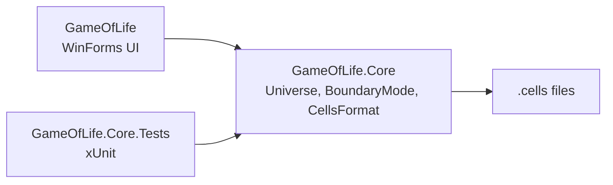

# Windows Game of Life

[](https://github.com/enonymous1/windows-game-of-life/actions/workflows/ci.yml)
[](LICENSE)


<!-- Hero screenshot, pending a real Windows capture. Do not link a
     placeholder: a broken image is worse than none. Capture the app
     running a glider on the default 20x20 grid (toolbar, control panel,
     and status bar visible), 1280x800 PNG, save it as
     docs/screenshots/main-window.png, then uncomment the line below.
 -->

## Description

Windows Game of Life is Conway's Game of Life for Windows. Paint cells,
press Start, and watch generations unfold: a live cell with two or three
live neighbours survives, a dead cell with exactly three live neighbours
is born, and every other cell dies or stays dead.

This is a modernization of a 2021 WinForms project, originally built on
.NET Framework 4.5.2. Version 2.0.0 splits the simulation into a
testable core library and a WinForms front end, fixes save/load, edge
handling, and several long-standing bugs, and adds tests and CI. See
[CHANGELOG.md](CHANGELOG.md) for the full list.

## Prerequisites

- Windows. The app is WinForms, so it only runs on Windows. The
  simulation core and its tests run anywhere .NET 10 runs.
- The [.NET 10 SDK](https://dotnet.microsoft.com/download/dotnet/10.0).
  The runtime alone is not enough to build it. The SDK version is pinned
  in `global.json` (10.0.x, latest feature band); CI reads it, so there
  is no separate version in the workflow.
- Git, for cloning. Optional: Visual Studio 2022 with the .NET desktop
  development workload, updated to a version that supports .NET 10.

## Installation

```powershell
git clone https://github.com/enonymous1/windows-game-of-life.git
Set-Location windows-game-of-life
dotnet build GameOfLife.sln --configuration Release
```

Alternatively, extract the release zip into a folder and run the commands
below from that folder. No other setup is required: there are no
external services, API keys, or configuration files.

## Local Development

Run the app:

```powershell
dotnet run --project src/GameOfLife --configuration Release
```

Or open `GameOfLife.sln` in Visual Studio 2022, set `GameOfLife` as the
startup project, and press F5.

Run the tests (43 xUnit cases for the core: rules, both edge modes,
`.cells` round-trips, resizing, seeding, the incremental live-cell
count, the 1,000,000-cell load cap, and the bug regressions):

```powershell
dotnet test tests/GameOfLife.Core.Tests --configuration Release
```

Check the whole solution, including the WinForms app, and the formatting
gate that CI enforces:

```powershell
dotnet build GameOfLife.sln --configuration Release
dotnet test GameOfLife.sln --configuration Release
dotnet format GameOfLife.sln --verify-no-changes
```

The UI itself has no automated tests, so before opening a pull request,
run this manual smoke checklist on Windows: paint and drag cells, start
and step with F5 and F6, open `examples/glider.cells`, open a file wider
than 100 cells, switch Edges to Toroidal, resize the grid, randomize
with seed `42` twice to confirm you get the same pattern back, then
change the size, interval, and edge rule, close the app, and reopen it
to confirm those settings came back.

## Usage

<!-- Gameplay GIF, pending a real Windows capture. Record about 8 seconds
     with ScreenToGif or ShareX: paint a glider, press Start, watch it
     travel, pause, then open examples/blinker.cells. Export at 800 pixels
     wide, under 5 MB, save as docs/screenshots/gameplay.gif, then
     uncomment the line below.
 -->

- **Click** a cell to toggle it. **Click and drag** to paint a run of
  cells in the same state.
- **Start** (F5) runs generations on a timer, **Stop** pauses,
  **Next** (F6) steps once.
- **New** clears the grid. **Randomize** fills it at random; type a
  whole-number seed first and the same pattern comes back every time.
- **Width / Height / Resize** changes the grid (cells that still fit
  are kept). **Interval** sets the timer in milliseconds.
- **Edges** picks the edge rule: **Finite** (outside the grid counts
  as dead) or **Toroidal** (the grid wraps, left to right and top to
  bottom).
- **Cell color** (Game menu) changes the live-cell colour.
- **File > Open / Save / Save As** reads and writes `.cells` files.
  Two are included to try: `examples/glider.cells` and
  `examples/blinker.cells`.

The status bar shows the generation count, the number of live cells,
the grid size, and the edge rule. Grid size, interval, and edge rule
are saved on close to `%APPDATA%\windows-game-of-life\settings.json`
and restored on launch. Cell color is not saved yet.

## The `.cells` format

Plain text. Lines starting with `!` are comments and are ignored.
`O` is a live cell, `.` is a dead cell. Rows shorter than the widest
row are padded with dead cells. A loaded pattern starts at
generation 0; the file does not record the edge rule, so it opens
with whichever rule is currently selected. Files holding more than
1,000,000 cells are rejected.

```
!Glider
.O.
..O
OOO
```

## Architecture



```
src/GameOfLife.Core/     Simulation only, no UI: Universe, BoundaryMode,
                         CellsFormat (.cells read/write). Unit tested.
src/GameOfLife/          WinForms app: MainForm, LifePanel,
                         SimulationController, GameSettings, Program.
                         Built in code, no designer files or .resx.
tests/GameOfLife.Core.Tests/
                         xUnit tests for the rules, both edge modes,
                         .cells round-trips, and the bug fixes.
examples/                Sample .cells patterns.
docs/screenshots/        README images, once captured on Windows.
```

`GameOfLife.Core` has no reference to `System.Windows.Forms`, so the
rules can be tested headlessly and reused by any other front end.

## Deployment

There is no installer or MSIX package yet. Shipping is the publish
folder from a Windows machine:

```powershell
dotnet publish src/GameOfLife --configuration Release --runtime win-x64 --self-contained false
```

That produces a framework-dependent build in
`src/GameOfLife/bin/Release/net10.0-windows/win-x64/publish/`. The
executable is named `game-of-life.exe`, not `windows-game-of-life.exe`.
The target machine needs the .NET 10 Desktop Runtime; add
`--self-contained true` to the publish command for a machine without it.

To cut a release: make sure `Version` in `Directory.Build.props`
matches the version you are about to tag, commit that, then tag and
push the tag (for example `v2.0.0`). Pushing a `v*` tag triggers
`.github/workflows/release.yml`, which builds the solution, runs the
tests, publishes a framework-dependent win-x64 build, and attaches
`game-of-life-win-x64.zip` (plus a `.sha256` checksum file) to the
GitHub release. The attached zip is the framework-dependent build: the
machine running it needs the .NET 10 Desktop Runtime. CI runs
build, test, and format on Ubuntu and Windows on every push to `main`
and every pull request; see `.github/workflows/ci.yml`.

## Known limitations

- The WinForms UI has no automated tests; see the manual smoke
  checklist under Local Development.
- Cell color is not persisted between runs yet.
- Very large grids are slower to paint and step; keep grids modest
  for smooth animation.

## Contributing

Issues and pull requests are welcome. Before opening one, run the
build, the tests, and the format check under Local Development and
include the manual smoke checklist results for UI changes.

## License

MIT. See [LICENSE](LICENSE).
